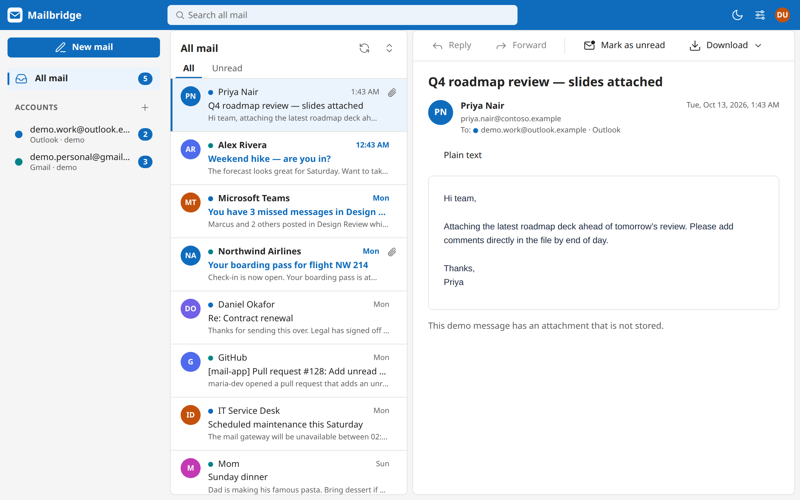
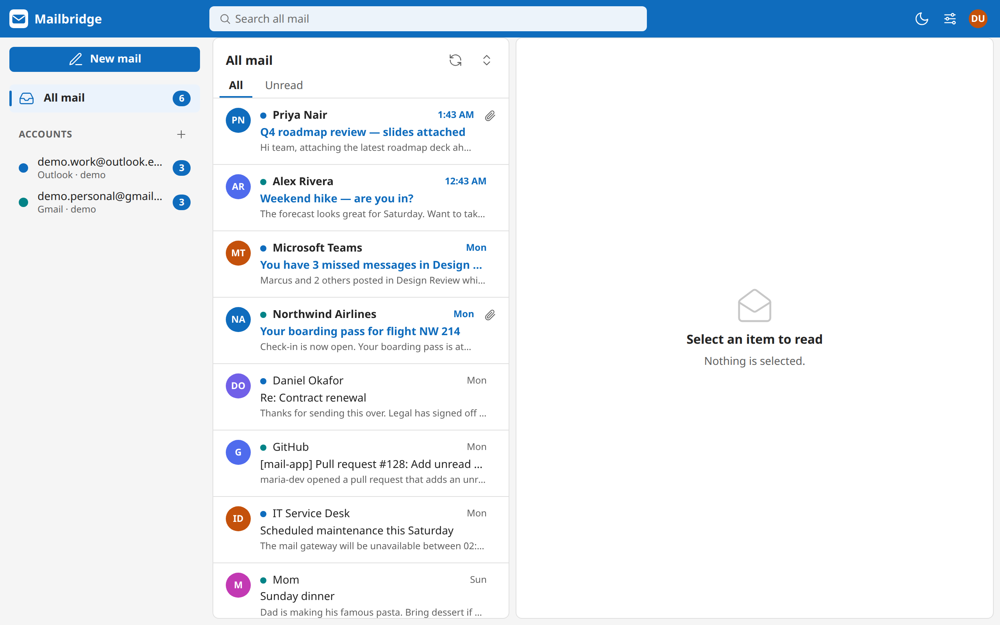
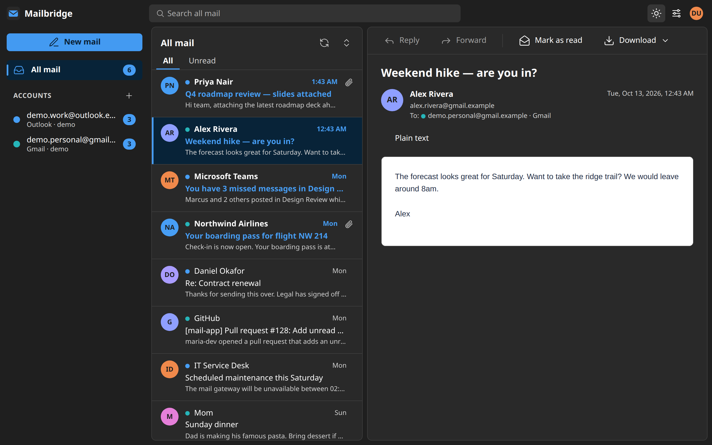
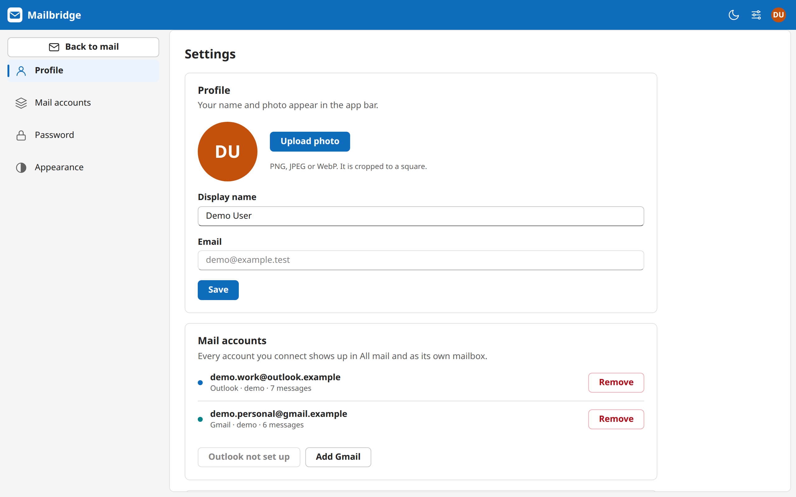
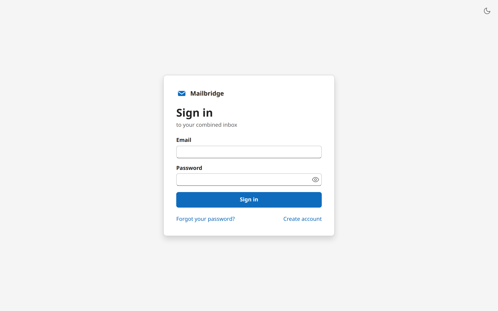
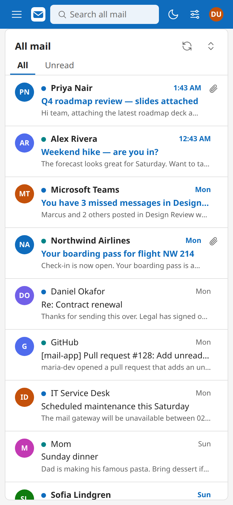
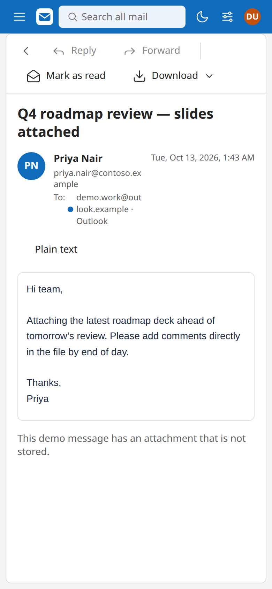
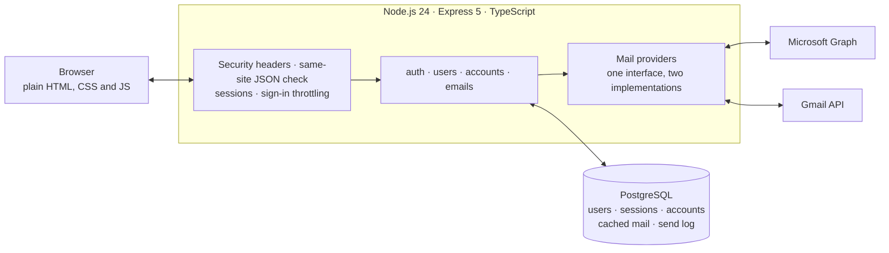
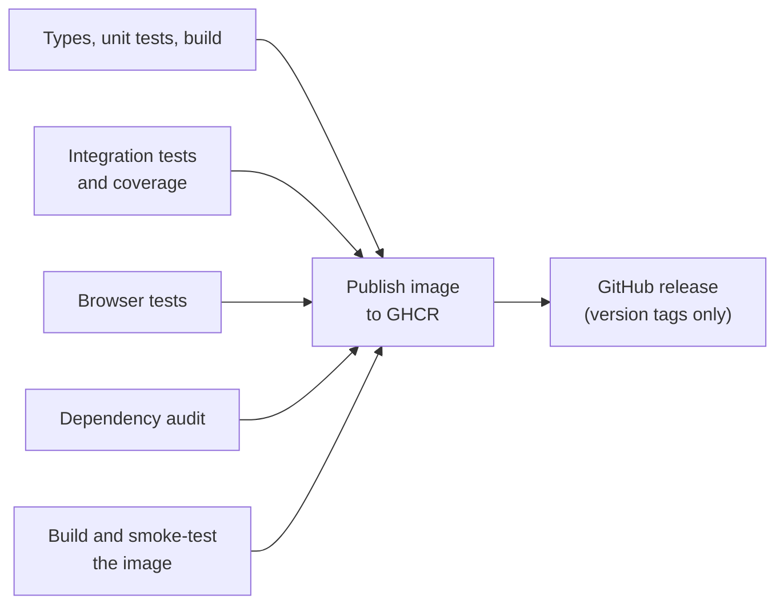

<div align="center">


# Mailbridge

**Outlook and Gmail in one inbox.**

Connect any number of mailboxes and read them together, with each account still one click away in the sidebar.

[](https://github.com/rossiko22/Mailbridge/actions/workflows/ci.yml)
[](https://github.com/rossiko22/Mailbridge/actions/workflows/codeql.yml)




</div>

## Contents

- [What it does](#what-it-does)
- [Screenshots](#screenshots)
- [How it works](#how-it-works)
- [Security](#security)
- [Quick start](#quick-start)
- [Connecting real mailboxes](#connecting-real-mailboxes)
- [Configuration](#configuration)
- [Testing](#testing)
- [CI/CD](#cicd)
- [Deployment](#deployment)
- [Project layout](#project-layout)

## What it does

- **One inbox for every account.** Mail from all connected Outlook and Gmail accounts appears in a single list, colour-coded by mailbox, with per-account views, an unread filter, search and sorting.
- **Read mail safely.** Message bodies render in a sandboxed frame that cannot run scripts, and remote images stay off until you ask for them.
- **Reply, forward and compose** from any connected account. Read state is written back to the provider, so Outlook and Gmail stay in step.
- **Attachments and export.** Download attachments, or save any message as an `.eml` file.
- **Accounts and profile.** Sign up, sign in, reset a forgotten password by email, change your name and photo, and switch between light and dark themes.
- **Works without any setup.** A seeded demo user with two demo mailboxes lets you try the whole interface before registering an OAuth app.

## Screenshots

| Light | Dark |
| --- | --- |
|  |  |
|  |  |

<p align="center">
  
  &nbsp;&nbsp;
  
</p>

These pictures are produced by the browser tests, so they always show the current interface. To refresh them:

```sh
SCREENSHOT_DIR=docs/screenshots npm run test:e2e
```

## How it works



- **No front-end build step.** The interface is hand-written HTML, CSS and JavaScript served as static files.
- **One provider interface.** Outlook and Gmail each implement the same small `MailClient` contract (sync, body, attachments, send, mark read), so the rest of the app never asks which provider it is talking to.
- **Incremental sync.** The first sync loads the last 90 days of the inbox. After that, only changes are fetched: Graph delta links for Outlook and history IDs for Gmail. An expired checkpoint rebuilds itself.
- **Gmail quota aware.** Gmail allows 6,000 quota units per mailbox per minute. The client budgets its requests, and when Google reports the minute is used up it waits for the next one instead of failing.
- **Sends are never duplicated.** Every send carries a request ID that is recorded before the provider is called. A retry of an accepted request is answered from the record, and an uncertain outcome is reported as uncertain rather than retried.

## Security

| Area | What is done |
| --- | --- |
| Passwords | Argon2id (128 MiB, 3 passes). Reset tokens are single-use, expire after 30 minutes, are stored only as a hash and travel in the URL fragment. |
| Sessions | Server-side sessions in PostgreSQL. The cookie is `HttpOnly`, `SameSite=Lax` and `Secure` in production. The session ID is replaced on sign-in, and changing or resetting a password signs out every session. |
| Request forgery | Every state-changing request must be same-site `application/json`; cross-site and foreign-origin requests are refused. |
| Brute force | Sign-in, registration and reset attempts are counted per address and per account. Counter keys are HMAC-hashed, so the table stores no email or IP addresses. |
| OAuth | Authorization code flow with PKCE and a single-use `state`. Tokens are encrypted with AES-256-GCM and bound to their account row, and they never reach the browser. |
| Mail content | HTML is sanitized and shown in a sandboxed frame under its own Content-Security-Policy. Sync cursors are validated so a stored URL can never send a token to another host. |
| Data isolation | Every query is scoped to the signed-in user. Another person's mail and accounts answer `404`. |
| Headers | Strict Content-Security-Policy, `X-Frame-Options: DENY`, `nosniff`, `no-referrer`, and HSTS in production. |
| Container | Runs as a non-root user on a read-only filesystem with all capabilities dropped. |

Each row above is exercised by the test suite described under [Testing](#testing).

## Quick start

You need Node.js 24 and Docker.

```sh
npm ci
cp .env-example .env
docker compose up -d postgres
npm run migration
npm run seed        # demo user demo@example.test / Demo-Password-123! with two demo mailboxes
npm run dev         # http://localhost:3000
```

Without OAuth credentials the demo mailboxes still work; the Connect buttons stay disabled until a provider is configured. Without SMTP, password reset links are printed to the server log (development only).

To browse the database, run `docker compose up -d pgadmin` and open http://localhost:5050. Sign in with `PGADMIN_DEFAULT_EMAIL` / `PGADMIN_DEFAULT_PASSWORD` from `.env`; the Mailbridge server is already listed and asks for `POSTGRES_PASSWORD`.

## Connecting real mailboxes

Register an app with each provider and set the redirect URIs:

| Provider | Redirect URI | Env vars | Scopes |
| --- | --- | --- | --- |
| Microsoft (Entra app registration) | `<PUBLIC_ORIGIN>/accounts/callback/outlook` | `MICROSOFT_CLIENT_ID`, `MICROSOFT_CLIENT_SECRET`, `MICROSOFT_TENANT` | `User.Read Mail.ReadWrite Mail.Send offline_access` |
| Google (Cloud console, OAuth client "Web") | `<PUBLIC_ORIGIN>/accounts/callback/gmail` | `GOOGLE_CLIENT_ID`, `GOOGLE_CLIENT_SECRET` | Gmail API: `gmail.modify` and `gmail.send` |

Notes:

- `MICROSOFT_TENANT` must match the app registration's supported account types: `common` for work, school and personal accounts, `consumers` for personal accounts only, or a tenant ID for one organisation.
- `GMAIL_ALLOWED_EMAILS=a@x.com,b@y.com` limits the Gmail option to those app users, which fits an unverified Google app limited to test users. Outlook stays open to everyone.
- Gmail's mail scopes are *restricted*. While the Google app is in "Testing", only listed test users can connect and tokens expire after 7 days; public use needs Google's verification.
- A large Gmail inbox syncs at roughly 270 messages per minute because of Google's per-mailbox quota.
- Gmail forwards do not include the original attachments.
- Migration `008_unified_mailboxes.sql` replaces the old ticket schema and **deletes previously cached emails** (they are re-synced from the provider). It is not reversible.

## Configuration

All settings are environment variables; see [.env-example](.env-example) for development and [.env.production.example](.env.production.example) for production.

| Variable | Purpose |
| --- | --- |
| `PUBLIC_ORIGIN` | Public address of the app. Required in production, where it must be HTTPS. |
| `SESSION_SECRET`, `TOKEN_ENCRYPTION_KEY` | Sign sessions and encrypt stored mailbox credentials. At least 32 characters each in production. |
| `ALLOW_REGISTRATION` | Set to `false` to stop new sign-ups. |
| `MICROSOFT_*`, `GOOGLE_*` | OAuth app credentials. A provider without them is simply not offered. |
| `GMAIL_ALLOWED_EMAILS` | Optional invite list for the Gmail option. |
| `SMTP_*` | Outgoing mail for password resets. |
| `POSTGRES_*` | Database connection. |
| `PGADMIN_*` | Local pgAdmin sign-in and port (development only). |

## Testing

The suite has three layers, all on Node's built-in test runner with no extra test framework.

| Layer | Command | Needs | What it covers |
| --- | --- | --- | --- |
| Unit | `npm test` | nothing | Gmail and Outlook clients against recorded responses, quota budgeting and backoff, cursor validation, MIME handling, HTML sanitizing, credential encryption, validation rules |
| Integration | `npm run test:integration` | PostgreSQL | The real app over HTTP against a real database: registration, sign-in, sessions, throttling, password reset, request-forgery checks, security headers, data isolation between users, the OAuth flow, sync, and send idempotency |
| Browser | `npm run test:e2e` | PostgreSQL, Chromium | Sign-in, the inbox, opening a message, filters and search, themes, settings, sign-out and the phone layout. Any console error or Content-Security-Policy violation fails the test |

```sh
npm run check            # typecheck (source and tests), unit tests, build
npm run test:coverage    # unit + integration with coverage thresholds
npm run test:all         # all three layers
npx playwright install chromium   # once, before the first browser run
```

- **A separate database.** Integration and browser tests use `<POSTGRES_DB>_test`, created and migrated automatically, so they never touch development data.
- **No network.** Google and Microsoft are replaced by in-process stand-ins; an unexpected outbound request fails the test.
- **Coverage is enforced.** `test:coverage` fails below 90% of lines, 75% of branches or 85% of functions. It currently reports 93%, 80% and 90%.

## CI/CD

Every pull request and every push to `main` runs [`.github/workflows/ci.yml`](.github/workflows/ci.yml):



| Job | What it checks |
| --- | --- |
| Types, unit tests, build | Strict TypeScript over source and tests, the unit suite, and a production build |
| Integration tests and coverage | Migrations run twice against PostgreSQL 18 to prove they are re-runnable, then the unit and integration suites run under the coverage thresholds. The coverage table is added to the run summary |
| Browser tests | The Playwright suite in Chromium. Screenshots of every screen are kept as an artifact for 14 days |
| Dependency audit | `npm audit` for production dependencies, plus a review of dependencies added by a pull request |
| Build and smoke-test the image | Builds the Docker image, checks it does not run as root, then starts it in production mode on a read-only filesystem and waits for a healthy `/health` |
| Publish image | On `main` and version tags only, after every job above passes: pushes `ghcr.io/rossiko22/mailbridge` with a signed build provenance attestation |
| GitHub release | On a `v*` tag, creates a release with generated notes |

Alongside it:

- **CodeQL** ([`codeql.yml`](.github/workflows/codeql.yml)) scans the code for security problems on every push, pull request and weekly.
- **Dependabot** ([`dependabot.yml`](.github/dependabot.yml)) opens weekly grouped updates for npm packages, GitHub Actions and the Docker base image.

To cut a release:

```sh
git tag v1.1.0
git push origin v1.1.0
```

That publishes the image as `1.1.0`, `1.1` and by commit, and creates the GitHub release. Pushes to `main` publish `latest`.

## Deployment

[`compose.production.yaml`](compose.production.yaml) runs the app, PostgreSQL and Caddy (automatic HTTPS) on one host.

```sh
cp .env.production.example .env.production      # fill in secrets, domain and OAuth apps
docker compose --env-file .env.production -f compose.production.yaml up -d --build
docker compose --env-file .env.production -f compose.production.yaml exec app node dist/scripts/migrate.js
```

- The compose file builds the image on the host. To run the image published by CI instead, set the `app` service's `image` to `ghcr.io/rossiko22/mailbridge:latest` and remove `build`.
- [`deploy/backup.sh`](deploy/backup.sh) writes a database dump to `backups/`; keep copies off the host.
- [`deploy/smoke-test.sh`](deploy/smoke-test.sh) is the same check CI runs against the image.
- If someone is locked out, `npm run admin:reset-password` sets a new password from the server. It reads `RESET_USER_EMAIL` and `RESET_USER_PASSWORD` (at least 16 characters) from the environment.

## Project layout

```
src/
  app.ts, server.ts        Express wiring and startup
  config/                  environment parsing and the database pool
  middleware/              security headers, same-site check, sessions, throttling, errors
  modules/
    auth/                  sign-in, registration, password reset
    users/                 profile and photo
    accounts/              connected mailboxes and the OAuth callback
    emails/                listing, reading, sending, export, HTML sanitizing
  integrations/
    mail/                  the provider contract shared by both mail services
    gmail/, outlook/       the two implementations
  security/                password hashing and credential encryption
  scripts/                 migrations, demo data, admin tools
public/                    the interface: HTML, CSS, JavaScript, icons
database/migrations/       SQL migrations
tests/                     unit tests, plus integration/, e2e/ and support/
deploy/                    Caddy config, backup and smoke-test scripts
```
