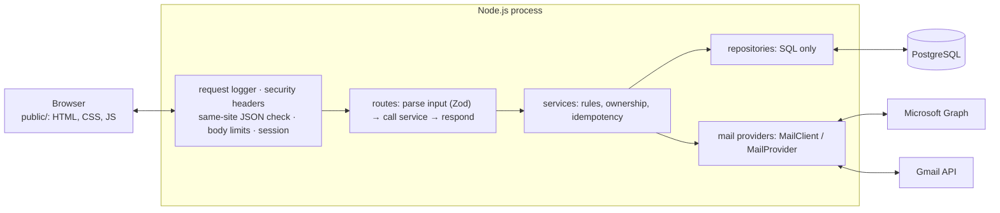

# Architecture

Mailbridge is one Node.js process (Express 5, TypeScript) in front of one PostgreSQL database, serving a static,
framework-free web interface. It talks to two mail providers, Microsoft Graph and the Gmail API, on behalf of each
signed-in person. Decisions with their reasons are in [adr/](adr/).



## Request path

1. **`createRequestLogger`** (pino-http) gives the request a server-generated ID, returned as `X-Request-ID`, and
   writes one JSON line when it finishes: method, path without query string, status, time, user ID, client IP.
2. **`createSecurityHeaders`** sets the CSP and the other security headers on every response, HSTS in production.
3. **`createRequireSameSiteJson`** refuses any state-changing request that is not `application/json`, is marked
   `Sec-Fetch-Site: cross-site`, or names a foreign `Origin`: the CSRF defence (no tokens needed, see ADR 0004).
4. **Body parsers** with small limits (64 KiB; 800 KiB for the profile photo route only).
5. **Session** from PostgreSQL (`connect-pg-simple`), cookie `__Host-session` in production.
6. **Throttles** on sign-in, registration, reset, password change, sending, connecting and photo uploads.
7. **Routers** (`/auth`, `/users`, `/accounts`, `/emails`), each `requireAuth` where needed.
8. **Static files** from `public/` (pages `no-store`, assets `no-cache` with ETags), then a JSON `404`.
9. **`errorMiddleware`** turns any thrown error into `{"error":{"code","message"}}`. Only `AppError` messages reach
   the client; everything else is a `500 internal_error`, logged by type, code and stack, never by message.

## Modules

Every module has the same shape. Dependencies are passed in; nothing imports a global pool.

```
src/modules/<name>/
  <name>.schemas.ts      Zod schemas for request input, mirroring contracts/openapi.yaml
  <name>.routes.ts       createXRouter({ service, requireAuth, audit }): parse → call → respond
  <name>.service.ts      createXService(...): rules, ownership checks, provider calls
  <name>.repository.ts   createXRepository(pool): SQL only, always scoped by user_id
```

`src/app.ts` builds the whole application with `createApp({ pool, env, logger })`; `src/server.ts` (and the test
harness) create those three and nothing else does. `src/config/env.ts` validates every setting once at startup.

| Module | Owns |
| --- | --- |
| `auth` | sign-up, sign-in, sign-out, password change and reset, the current user, the person's own activity |
| `users` | display name and profile photo |
| `accounts` | connected mailboxes, the OAuth connect and callback flow, sync trigger, removal |
| `emails` | the combined inbox (keyset pages, search), reading, export, attachments, reply, forward, compose |
| `audit` | the security event log (insert-only) |

## Mail providers

`src/integrations/mail/types.ts` is the boundary: the rest of the app only knows `MailClient` (sync, body,
attachments, MIME, send, compose, set read) and `MailProvider` (begin and complete OAuth, make a client). Outlook
(`outlook/`, MSAL + Graph) and Gmail (`gmail/`, OAuth + Gmail API) implement them. An IMAP provider would be a third
implementation and nothing else would change.

Outbound calls only go to fixed Google and Microsoft hosts, refuse redirects, time out after 30 s and cap downloads at
25 MiB. Stored Graph continuation URLs are checked against an allowlist of paths before a token is attached to them.

**Credentials** are stored encrypted (AES-256-GCM, account ID as associated data, versioned format with a key ID; see
ADR 0006). The `CredentialStore` reads them without a lock; a token refresh (once per account at a time per process)
is saved with compare-and-swap, so no database connection waits on the network.

**Sync** is pulled by the browser, one page per request: the first sync takes the last 90 days, later ones only
changes (Graph delta links, Gmail history IDs). An account is claimed with a five-minute lease
(`mail_accounts.sync_lease_*`), the page is fetched with no connection held, and saved in a short transaction only if
the lease is still valid.

## Data

| Table | Holds | Notes |
| --- | --- | --- |
| `users` | accounts of this app | email unique ignoring case; Argon2id hash |
| `sessions` | server-side sessions | deleted on password change or reset |
| `login_attempts` | throttle counters | keys are HMAC hashes: no addresses stored |
| `password_resets` | reset tokens | only a SHA-256 hash; single use; 30 minutes |
| `user_avatars` | profile photos | ≤ 512 KiB, signature-checked |
| `mail_accounts` | connected mailboxes | encrypted credentials, sync cursor and lease |
| `emails` | saved copies of inbox messages | `search_vector` (full text), trigram and inbox-order indexes |
| `email_bodies` | fetched HTML or text bodies | cache; deleted with the message |
| `outgoing_messages` | every send by request ID | idempotency and the reply/forward history |
| `audit_events` | security events, 90 days | insert-only, enforced by triggers (migration 010) |

Saved mail is a cache of the provider: losing it costs a resync, not data. Users, credentials and the audit log are
the data that matters for backups.

**Migrations** (`database/migrations`, node-pg-migrate SQL files) run as the table owner before the new version
starts. Every migration after 008 has a tested `Down` section; 008 (the move away from the ticket system) is one-way.
In production the app should connect as `mailbridge_app` (`deploy/db-roles.sql`), which can read and write rows but
cannot change the schema, truncate tables or touch the audit log's guard.

## Browser

Plain HTML pages with one script each, sharing `core.js` (API calls, menus, the app bar) through `window.App`. No
inline script or style: the CSP allows only `'self'`. Mail bodies are rendered on the server into a sanitized
document, shown in a sandboxed iframe with its own CSP (`script-src 'none'`), remote images only on request. The
scripts are type-checked with JSDoc (`tsconfig.public.json`) but shipped as written.

## Limits worth knowing

- **One process.** The Gmail quota budget is in memory, and sync only happens while someone has the app open.
  Background sync and push notifications need a worker (see BACKLOG.md and docs/analysis.md §4).
- **Google restricted scopes.** Gmail needs verification for general use; until then, Testing mode (listed users,
  refresh tokens that expire after 7 days). See docs/analysis.md §5.
